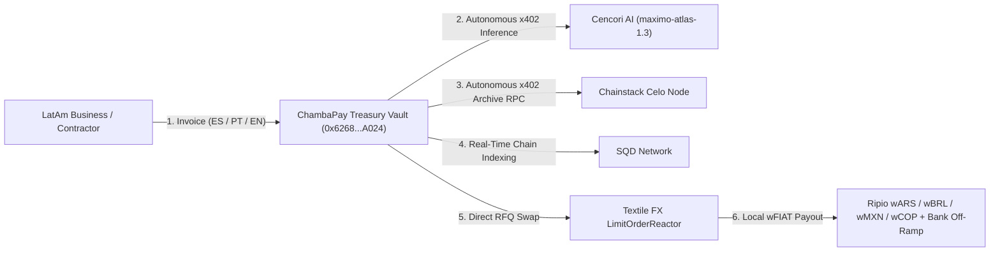

# ⚡ ChambaPay — *Tu Money, Sin Borders*

> **Autonomous Cross-Border Payroll, Invoice Autopilot & Local Currency Treasury for Latin America**
> Live at **[chamba-pay.vercel.app](https://chamba-pay.vercel.app)** · Powered by **Celo Mainnet (`Chain ID: 42220`)**

---

##🌎 Overview

Across Latin America (Argentina, Brazil, Mexico, Colombia, Peru, and Chile), fast-growing companies, studios, and remote teams earn in USD (`USA₮`, `USDC`, `USDT`) while paying salaries, contractors, and suppliers in local currencies (`ARS`, `BRL`, `MXN`, `COP`, `PEN`, `CLP`). Legacy cross-border wires and double-dollar conversions cost **4.5%–8% in FX spreads** and take days to reconcile.

**ChambaPay** automates the entire accounts-payable and cross-border treasury workflow:
1. **AI Invoice Autopilot:** Drop any messy bill, PDF text, or WhatsApp invoice in Spanish, Portuguese, or English. ChambaPay autonomously pays for machine-to-machine LLM extraction (`Cencori`) and real-time chain state verification (`Chainstack` & `SQD`) via `@celo/buy` (`x402`).
2. **Institutional RFQ FX Routing:** Quotes and executes permissionless orderbook swaps through **Textile FX** (`LimitOrderReactor` + `Permit2`) across USD and local stablecoins.
3. **Direct Local Currency Settlement (`wFIAT`):** Disburses funds directly in **Ripio `wFIAT`** (`wARS`, `wBRL`, `wMXN`, `wCOP`, `wPEN`, `wCLP`) with 1-click local bank off-ramps (`Mercado Pago`, `Pix`, `SPEI`).
4. **Gasless `x402` Treasury API:** Exposes an HTTP 402 programmable settlement gate (`/api/x402-execute`) supporting gasless `USA₮` (`EIP-3009`) and `wARS`/`wBRL` (`Permit2`) settlements via Celo's native facilitator (`https://api.x402.celo.org`).

---

## 🏗️ System Architecture



---

## 🛡️ On-Chain Treasury Identity & Cryptographic Audit Trail

| Property | Mainnet Value / Verification |
| :--- | :--- |
| **Settlement Network** | **Celo Mainnet (`Chain ID: 42220`)** |
| **Treasury Vault & Agent Wallet** | [`0x6268689797cA15256AF2ce922836cd69940FA024`](https://celoscan.io/address/0x6268689797cA15256AF2ce922836cd69940FA024) |
| **ERC-8004 Agent Identity Registry** | [`0x8004A169FB4a3325136EB29fA0ceB6D2e539a432`](https://celoscan.io/address/0x8004A169FB4a3325136EB29fA0ceB6D2e539a432) |
| **ERC-8004 Identity Certificate Tx** | [`0x5af7d535677949486b771b9983ee64ef0cdf7716c20be710e7a7c7ad03293345`](https://celoscan.io/tx/0x5af7d535677949486b771b9983ee64ef0cdf7716c20be710e7a7c7ad03293345) |
| **8004scan Verified Profile** | [View Certificate on 8004scan.io](https://8004scan.io/agents?chain=42220&search=0x6268689797cA15256AF2ce922836cd69940FA024) |
| **ERC-8021 Audit Tag** | `celo_42cd0161c62d` |

---

## ✅ Verified Celo Mainnet Settlement Ledger

### Autonomous Infrastructure & AI Compute (`@celo/buy` / `x402`)
- **Cencori AI Invoice Extraction (`x402` Settlement #1):** [`0xfeea65ea7765145395d558f8a1e1fa556da825a2fa88126bd10f6bd9e16546aa`](https://celoscan.io/tx/0xfeea65ea7765145395d558f8a1e1fa556da825a2fa88126bd10f6bd9e16546aa)
- **Cencori AI Invoice Extraction (`x402` Settlement #2):** [`0x16f1cf209212103f8022021ac1d32ae30e0ef60636647f9967b5152aa1028b40`](https://celoscan.io/tx/0x16f1cf209212103f8022021ac1d32ae30e0ef60636647f9967b5152aa1028b40)
- **Cencori AI Invoice Extraction (`x402` Settlement #3):** [`0xcba16c7b553a42a1cdf46df332fe76baa49eb377ff9ef76bfacdab741527758b`](https://celoscan.io/tx/0xcba16c7b553a42a1cdf46df332fe76baa49eb377ff9ef76bfacdab741527758b)
- **Chainstack Archive Node Verification (`x402` Settlement #1):** [`0x76d0f16a454c1a3f930e735aaaf5a1e24e9ac6cd3a30faabf9745716998cf6b5`](https://celoscan.io/tx/0x76d0f16a454c1a3f930e735aaaf5a1e24e9ac6cd3a30faabf9745716998cf6b5)
- **Chainstack Archive Node Verification (`x402` Settlement #2):** [`0xf6862a9c3349fed7e390b21bc7713cc6b8416577761d9897d0c39d73027bc8b2`](https://celoscan.io/tx/0xf6862a9c3349fed7e390b21bc7713cc6b8416577761d9897d0c39d73027bc8b2)

### LatAm Local Currency Settlements (`Ripio wFIAT`)
- **🇦🇷 `wARS` (Argentine Peso — `0x0dc4f92879b7670e5f4e4e6e3c801d229129d90d`):** [`0xc6fc10b47c41dbcd2edc63666f72016d426684832458e5a1ec29ecbe72d0df17`](https://celoscan.io/tx/0xc6fc10b47c41dbcd2edc63666f72016d426684832458e5a1ec29ecbe72d0df17)
- **🇧🇷 `wBRL` (Brazilian Real — `0xd76f5faf6888e24d9f04bf92a0c8b921fe4390e0`):** [`0x729050303922baf86b3ad325ba6013e9b2ade25a9ea99a3d022f975e58e5c72a`](https://celoscan.io/tx/0x729050303922baf86b3ad325ba6013e9b2ade25a9ea99a3d022f975e58e5c72a)
- **🇲🇽 `wMXN` (Mexican Peso — `0x337e7456b420bd3481e7fa61fa9850343d610d34`):** [`0x88f29b869500a6098681803ea2d052301b0c9d73383fec61012804b2f02d1122`](https://celoscan.io/tx/0x88f29b869500a6098681803ea2d052301b0c9d73383fec61012804b2f02d1122)
- **🇨🇴 `wCOP` (Colombian Peso — `0x8a1D45e102e886510e891d2Ec656a708991e2D76`):** [`0x1c9a74e5152002113e74c5b2405e108d6699655c78b21dfa80b43c38aa4c9adf`](https://celoscan.io/tx/0x1c9a74e5152002113e74c5b2405e108d6699655c78b21dfa80b43c38aa4c9adf)
- **🇵🇪 `wPEN` (Peruvian Sol — `0x4F34c8b3b5FB6D98Da888F0feA543d4d9C9F2eBE`):** [`0x3c1171b8d9dc710275dc195f4a9046f790c750af0a5bab86bb82a873968cd328`](https://celoscan.io/tx/0x3c1171b8d9dc710275dc195f4a9046f790c750af0a5bab86bb82a873968cd328)
- **🇨🇱 `wCLP` (Chilean Peso — `0x61D450a098b6a7f69fC4b98CE68198fe59768651`):** [`0x867e4cbc8eab4dacb981654e6a97fcd6e04cb53632474f2ab696727b48c0cbaf`](https://celoscan.io/tx/0x867e4cbc8eab4dacb981654e6a97fcd6e04cb53632474f2ab696727b48c0cbaf)

### Institutional FX Corridors (`Textile FX`) & `USA₮` (`x402`)
- **Textile FX `Permit2` Liquidity Authorization (`USDC`):** [`0x930e1ec1d1cdf9a88b71133e4ef188d424f103b1f9101551d9fca49f7664aa37`](https://celoscan.io/tx/0x930e1ec1d1cdf9a88b71133e4ef188d424f103b1f9101551d9fca49f7664aa37)
- **Textile FX `cNGN` Corridor Settlement:** [`0x9b70a9695388b3eeac53ffe689f9851dee39cdefc5bf3dc30f9f1be51d97a942`](https://celoscan.io/tx/0x9b70a9695388b3eeac53ffe689f9851dee39cdefc5bf3dc30f9f1be51d97a942)
- **Tether `USA₮` Treasury Authorization (`0xD2ab3C9A02DBBAB236BfEC45D1d755DF4267F771`):** [`0x2b83a8b90bbdb38a058def21721650cdf38988d1132bd57c6dd36fd172b88948`](https://celoscan.io/tx/0x2b83a8b90bbdb38a058def21721650cdf38988d1132bd57c6dd36fd172b88948)

---

## 🚀 Local Development & CLI Operations

```bash
# Install dependencies
npm install

# Inspect live Celo Mainnet treasury balances & ERC-8004 certificate
npm run agent:status

# Run autonomous invoice extraction & settlement pipeline
npm run agent:buy-loop

# Start the web platform
npm run dev
```
