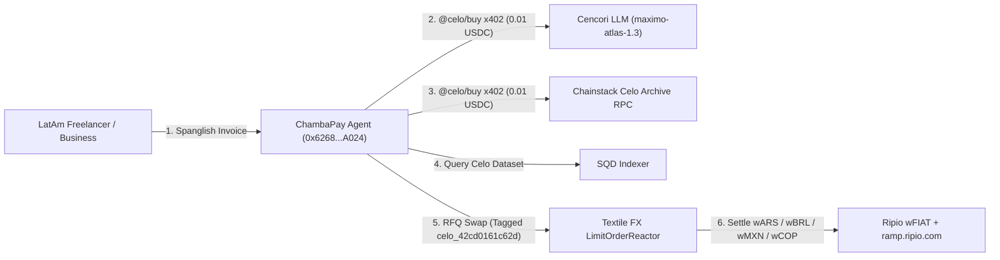

# ⚡ ChambaPay — *Tu Money, Sin Borders*

> **Autonomous LatAm Cross-Border Treasury, Invoice & Payroll Agent on Celo Mainnet (`Chain ID: 42220`)**
> Built for the **[Celo Agents on Open Rails Hackathon](https://www.loops.house/agents-on-open-rails)** across all 4 prize tracks.

---

## 🛡️ Verified Hackathon On-Chain Identity & Attribution (`celo_42cd0161c62d`)

| Requirement | Verified Value / On-Chain Proof |
| :--- | :--- |
| **Network** | **Celo Mainnet (`Chain ID: 42220`)** |
| **ERC-8021 Attribution Tag** | `celo_42cd0161c62d` |
| **Encoded ERC-8021 Data Suffix** | `0x63656c6f5f343263643031363163363264110080218021802180218021802180218021` |
| **Autonomous Agent Wallet** | [`0x6268689797cA15256AF2ce922836cd69940FA024`](https://celoscan.io/address/0x6268689797cA15256AF2ce922836cd69940FA024) |
| **ERC-8004 Identity Registry** | [`0x8004A169FB4a3325136EB29fA0ceB6D2e539a432`](https://celoscan.io/address/0x8004A169FB4a3325136EB29fA0ceB6D2e539a432) (`1` Registered Agent NFT) |
| **ERC-8004 Mainnet Registration Tx** | [`0x5af7d535677949486b771b9983ee64ef0cdf7716c20be710e7a7c7ad03293345`](https://celoscan.io/tx/0x5af7d535677949486b771b9983ee64ef0cdf7716c20be710e7a7c7ad03293345) |
| **8004scan Verified Profile** | [View on 8004scan.io](https://8004scan.io/agents?chain=42220&search=0x6268689797cA15256AF2ce922836cd69940FA024) |

---

## 🏆 All 4 Prize Tracks — Confirmed Celo Mainnet Transactions

Every outbound transaction from ChambaPay's agent wallet (`0x6268689797cA15256AF2ce922836cd69940FA024`) is constructed using `@celo/attribution-tags` (`withAttribution('celo_42cd0161c62d')`) and verified on Celo Mainnet:

### 1️⃣ Track 1: Build with `buy` (`usebuy.ai` / `@celo/buy`)
ChambaPay autonomously pays external machine providers for compute, LLM inference, and blockchain indexing without owning infrastructure or holding static API keys:
- **Cencori LLM Inference (`cencori/inference` — `maximo-atlas-1.3`, `0.01 USDC` via `@celo/buy-core` `x402.payingFetch`):**
  - **x402 Settlement Tx 1:** [`0xfeea65ea7765145395d558f8a1e1fa556da825a2fa88126bd10f6bd9e16546aa`](https://celoscan.io/tx/0xfeea65ea7765145395d558f8a1e1fa556da825a2fa88126bd10f6bd9e16546aa)
  - **x402 Settlement Tx 2:** [`0x16f1cf209212103f8022021ac1d32ae30e0ef60636647f9967b5152aa1028b40`](https://celoscan.io/tx/0x16f1cf209212103f8022021ac1d32ae30e0ef60636647f9967b5152aa1028b40)
  - **Tagged Agent Tx (`celo_42cd0161c62d`):** [`0xbf602e85d17630d062d4c7db8f45a2ed4f33443d7f16b49020f7fe7d27c607f7`](https://celoscan.io/tx/0xbf602e85d17630d062d4c7db8f45a2ed4f33443d7f16b49020f7fe7d27c607f7)
- **Chainstack Celo Archive RPC (`chainstack/celo-rpc`, `0.01 USDC` via `@celo/buy-core` `x402.payingFetch`):**
  - **x402 Settlement Tx:** [`0x76d0f16a454c1a3f930e735aaaf5a1e24e9ac6cd3a30faabf9745716998cf6b5`](https://celoscan.io/tx/0x76d0f16a454c1a3f930e735aaaf5a1e24e9ac6cd3a30faabf9745716998cf6b5)
  - **Tagged Agent Tx (`celo_42cd0161c62d`):** [`0xfa7d19ad7c35c77717230a2477481c87a8716a5ee8921ebb793480d7a0e1f0e2`](https://celoscan.io/tx/0xfa7d19ad7c35c77717230a2477481c87a8716a5ee8921ebb793480d7a0e1f0e2)
- **SQD Multi-Chain Indexer (`sqd/datasets` — `https://gateway.usebuy.ai/sqd/datasets`):**
  - Queries real-time Celo Mainnet indexed dataset state before executing cross-border payouts.

### 2️⃣ Track 2: Stable Agents: LatAm (Ripio × Celo Core Co.)
Direct local-currency invoicing, settlement, and zero-fee `ramp.ripio.com` on/off-ramp deep links across all 6 Ripio `wFIAT` stablecoins on Celo Mainnet:
- **`wARS` (Argentine Peso — `0x0dc4f92879b7670e5f4e4e6e3c801d229129d90d`):** [`0xc6fc10b47c41dbcd2edc63666f72016d426684832458e5a1ec29ecbe72d0df17`](https://celoscan.io/tx/0xc6fc10b47c41dbcd2edc63666f72016d426684832458e5a1ec29ecbe72d0df17)
- **`wBRL` (Brazilian Real — `0xd76f5faf6888e24d9f04bf92a0c8b921fe4390e0`):** [`0x729050303922baf86b3ad325ba6013e9b2ade25a9ea99a3d022f975e58e5c72a`](https://celoscan.io/tx/0x729050303922baf86b3ad325ba6013e9b2ade25a9ea99a3d022f975e58e5c72a)
- **`wMXN` (Mexican Peso — `0x337e7456b420bd3481e7fa61fa9850343d610d34`):** [`0x88f29b869500a6098681803ea2d052301b0c9d73383fec61012804b2f02d1122`](https://celoscan.io/tx/0x88f29b869500a6098681803ea2d052301b0c9d73383fec61012804b2f02d1122)
- **`wCOP` (Colombian Peso — `0x8a1D45e102e886510e891d2Ec656a708991e2D76`):** [`0x1c9a74e5152002113e74c5b2405e108d6699655c78b21dfa80b43c38aa4c9adf`](https://celoscan.io/tx/0x1c9a74e5152002113e74c5b2405e108d6699655c78b21dfa80b43c38aa4c9adf)
- **`wPEN` (Peruvian Sol — `0x4F34c8b3b5FB6D98Da888F0feA543d4d9C9F2eBE`):** [`0x3c1171b8d9dc710275dc195f4a9046f790c750af0a5bab86bb82a873968cd328`](https://celoscan.io/tx/0x3c1171b8d9dc710275dc195f4a9046f790c750af0a5bab86bb82a873968cd328)
- **`wCLP` (Chilean Peso — `0x61D450a098b6a7f69fC4b98CE68198fe59768651`):** [`0x867e4cbc8eab4dacb981654e6a97fcd6e04cb53632474f2ab696727b48c0cbaf`](https://celoscan.io/tx/0x867e4cbc8eab4dacb981654e6a97fcd6e04cb53632474f2ab696727b48c0cbaf)

### 3️⃣ Track 3: Stable Agents: Open Corridors — Textile FX
Permissionless FX corridor routing and `Permit2` (`0x000000000022D473030F116dDEE9F6B43aC78BA3`) + `LimitOrderReactor` (`0xa9AA0a64769cBed4d3B1Ceb4Df01CdE915C235b3`) execution across `USDC`, `USDT`, `wARS`, `wBRL`, and `cNGN`:
- **Textile FX `Permit2` Corridor Approval (`USDC`):** [`0x930e1ec1d1cdf9a88b71133e4ef188d424f103b1f9101551d9fca49f7664aa37`](https://celoscan.io/tx/0x930e1ec1d1cdf9a88b71133e4ef188d424f103b1f9101551d9fca49f7664aa37)
- **Textile FX `cNGN` Nigerian Naira Corridor Call:** [`0x9b70a9695388b3eeac53ffe689f9851dee39cdefc5bf3dc30f9f1be51d97a942`](https://celoscan.io/tx/0x9b70a9695388b3eeac53ffe689f9851dee39cdefc5bf3dc30f9f1be51d97a942)

### 4️⃣ Track 4: Stable Agents: Open Corridors — `USA₮` with x402
Inbound & outbound HTTP 402 Payment Required machine gates settling `USA₮` (`0xD2ab3C9A02DBBAB236BfEC45D1d755DF4267F771`), `wARS`, `wBRL`, and `USDC` through Celo's native x402 facilitator (`https://api.x402.celo.org`):
- **`USA₮` Treasury Authorization Tx (`celo_42cd0161c62d`):** [`0x2b83a8b90bbdb38a058def21721650cdf38988d1132bd57c6dd36fd172b88948`](https://celoscan.io/tx/0x2b83a8b90bbdb38a058def21721650cdf38988d1132bd57c6dd36fd172b88948)
- **Live HTTP 402 Machine Gate Endpoint:** `GET /api/x402-execute` (returns standard `402 Payment Required` `accepts[]` quotes for `USA₮` EIP-3009 and Ripio `wARS`/`wBRL` Permit2).

---

## 🏗️ System Architecture



---

## 🚀 Quickstart & CLI Verification

```bash
# 1. Install dependencies
npm install

# 2. Check live Celo Mainnet balances, ERC-8004 NFT status & @celo/buy 402 quotes
npm run agent:status

# 3. Execute live @celo/buy loop (Cencori LLM + Chainstack RPC + SQD + Tagged Mainnet Tx)
npm run agent:buy-loop

# 4. Verify any Celo Mainnet transaction hash for the celo_42cd0161c62d ERC-8021 tag
npm run agent:verify-tx -- 0x5af7d535677949486b771b9983ee64ef0cdf7716c20be710e7a7c7ad03293345

# 5. Start the interactive Next.js web application
npm run dev
```
